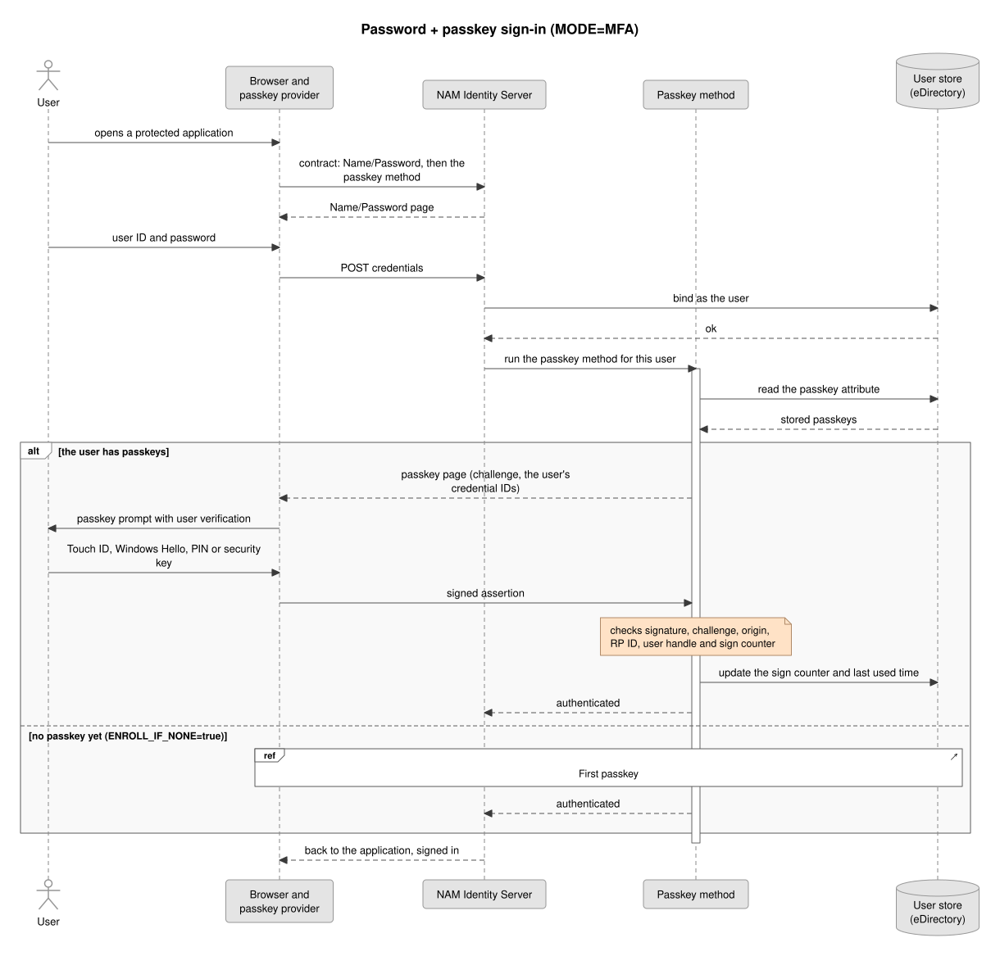
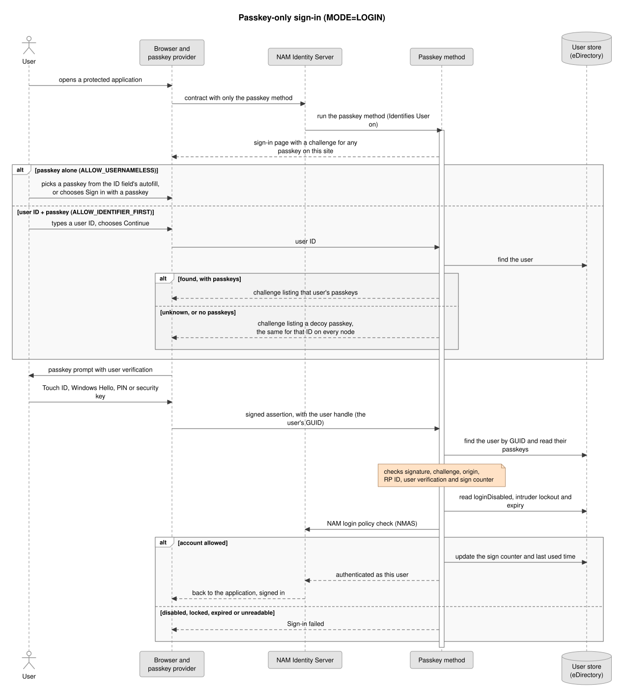
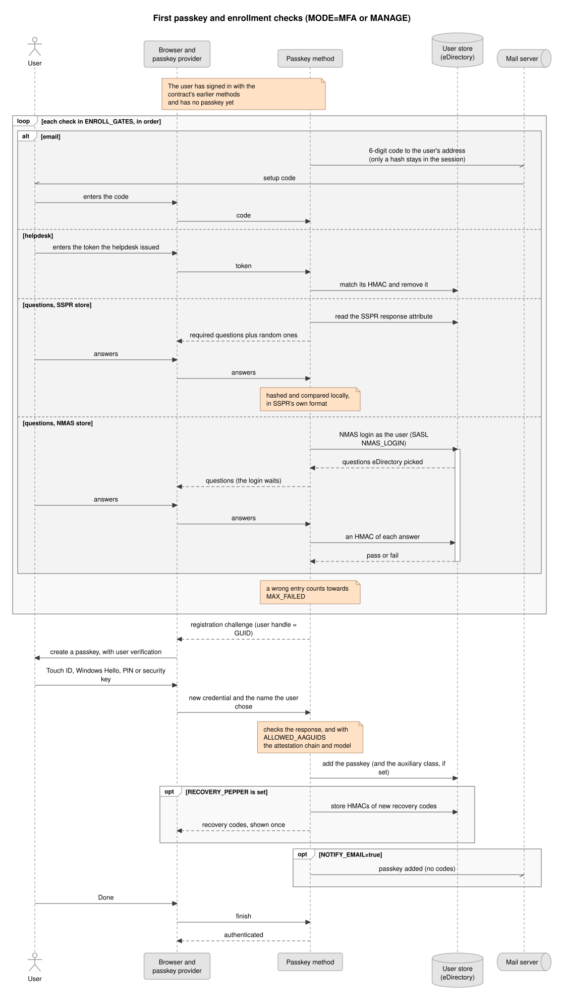
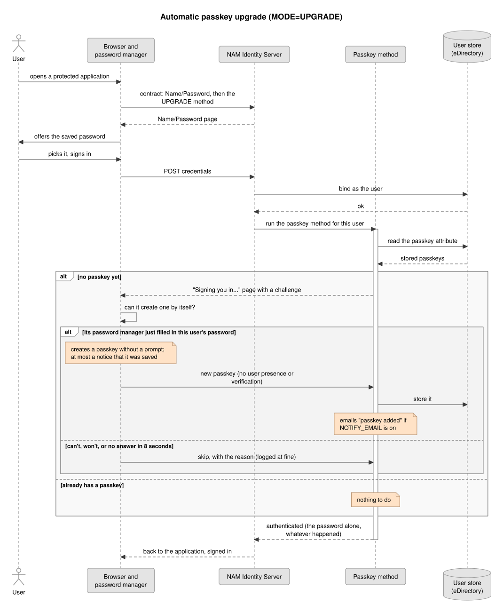
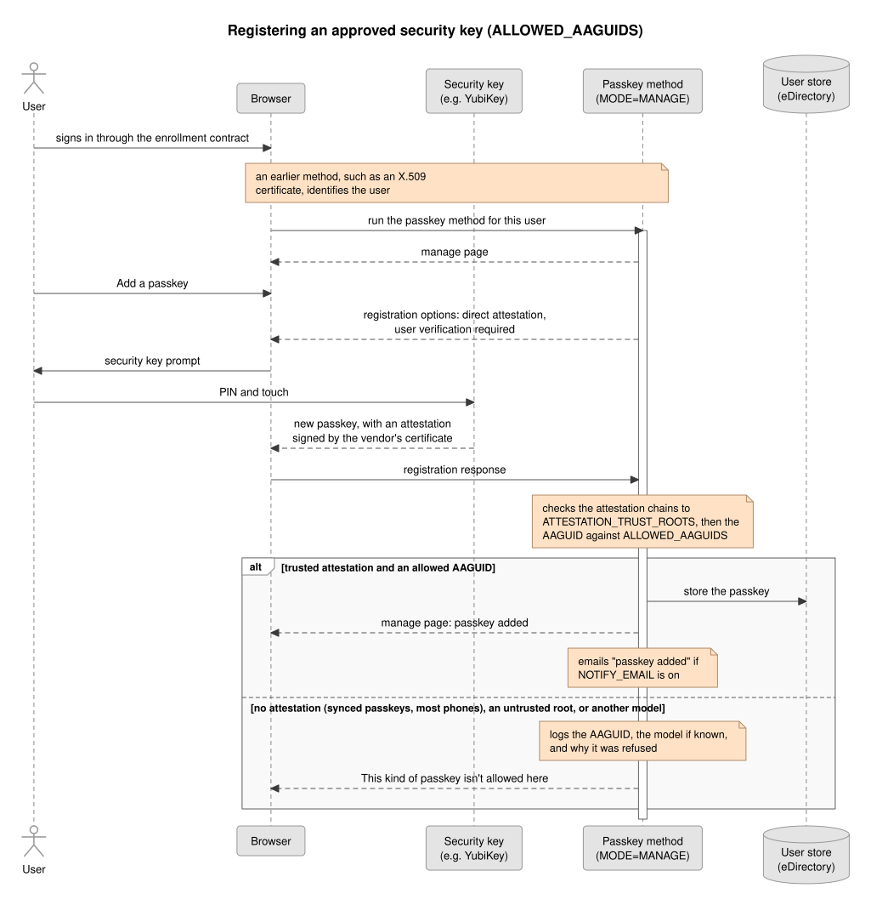
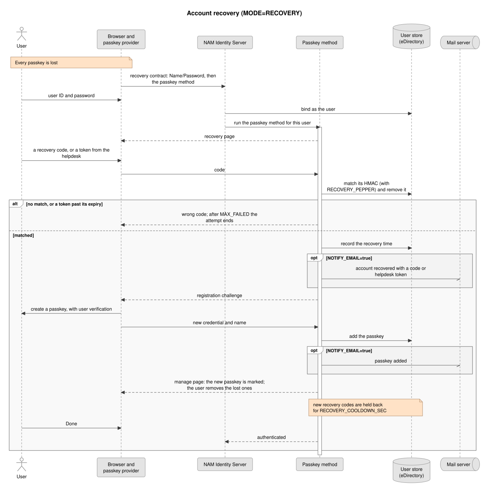
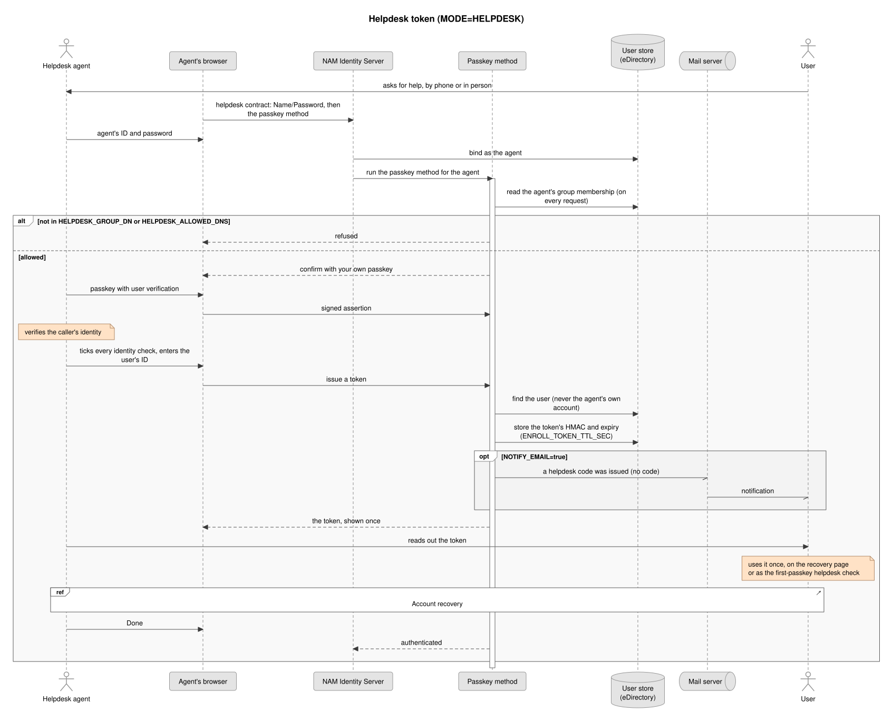

# Passkey authentication for OpenText Access Manager

A WebAuthn / passkey authentication class for the OpenText Access Manager (NAM) 5.1.3 / 26.2 Identity Server. Users sign in with a passkey after their password, with a user ID and a passkey, or with a passkey alone. Each user can keep several passkeys, stored on an attribute of their directory entry.

> **Not an OpenText product.** This is an independent project by PointBlue Technology. It isn't made, endorsed or supported by OpenText, so please don't contact OpenText support about it; use this repository's [issues](https://github.com/PointBlueTechnology/access-manager-passkey/issues) instead. It's built on Access Manager's supported extension points: the custom authentication class API and SDK that OpenText provides for adding sign-in methods to the Identity Server.

> **Implementation and support services** for this project are available from [Idenhaus Consulting](https://idenhaus.com).

> **Beta.** This is a pre-release. It has been tested on Access Manager 5.1.3 with eDirectory, but not yet in every setup: see [Status](#status). Try it in a test environment first, and please [report problems](https://github.com/PointBlueTechnology/access-manager-passkey/issues) or [security issues](SECURITY.md).

- **Sign-in:** password + passkey, user ID + passkey, and passkey alone, including from the browser's autofill
- **Self-service:** users list, rename, remove and add passkeys
- **Automatic upgrade:** optionally, the browser's password manager creates a passkey by itself after a saved password signs the user in
- **First passkey:** optional checks before a user's first passkey: an emailed code, a helpdesk code, or their SSPR or NMAS security questions
- **Recovery:** single-use recovery codes and helpdesk-issued tokens, with an optional cool-down after each recovery
- **Approved authenticators:** an optional allow-list of authenticator models, checked against vendor attestation
- **Notifications:** emails through NAM's own email configuration when passkeys or recovery details change
- **Deployment:** one jar and a set of JSPs, installed with NAM's Advanced File Configurator or a single-node installer

## Contents

- [Requirements](#requirements)
- [Status](#status)
- [Installing](#installing)
- [Contracts](#contracts)
- [Configuration](#configuration)
- [Password + passkey sign-in](#password--passkey-sign-in)
- [Signing in with only a passkey](#signing-in-with-only-a-passkey)
- [The first passkey](#the-first-passkey)
- [Automatic passkey upgrade](#automatic-passkey-upgrade)
- [Approved authenticators only](#approved-authenticators-only)
- [Managing passkeys](#managing-passkeys)
- [Recovery](#recovery)
- [Helpdesk tokens](#helpdesk-tokens)
- [Notification emails](#notification-emails)
- [Logging](#logging)
- [Schema](#schema)
- [Design and security](#design-and-security)
- [Building and testing](#building-and-testing)
- [Licenses](#licenses)

## Requirements

- OpenText Access Manager 5.1.3 / 26.2 Identity Server, reached over HTTPS on a DNS name (WebAuthn doesn't work on an IP address or over plain HTTP)
- Java 11 or newer on the Identity Server; passkeys that use Ed25519 need Java 15 or newer
- An eDirectory user store. The class has Active Directory code paths, but they're untested
- A browser with WebAuthn: current Chrome, Edge, Safari or Firefox. Passkeys in the ID field's autofill need a browser that offers them there (Chrome, Edge and Safari do). The [automatic upgrade](#automatic-passkey-upgrade) needs a browser whose password manager can create passkeys by itself; others skip it
- For `ENROLL_GATES=email` and notification emails: NAM's email configuration
- The pages are in English only; messages live in one properties file, ready for translations

## Status

This is a beta. What has been tested, and what hasn't yet:

| Area | Tested |
|---|---|
| Unit tests | Every ceremony against a software authenticator, configuration, recovery codes and tokens, emails, SSPR answer formats, the NMAS exchange against a fake server, log cleaning |
| Browser tests on Access Manager 5.1.3 + eDirectory | Passkey-only sign-in by button and autofill, refusing a disabled account, the fallback link, the emailed first-passkey code, SSPR security questions, recovery codes, helpdesk tokens, `MAX_FAILED`, nothing secret in the log ([details](docs/BUILDING.md#browser-tests)) |
| By hand | Touch ID with Safari and Chrome on macOS, including autofill |
| **Not yet** | Active Directory user stores; NMAS security questions against a live directory; the helpdesk first-passkey check, the authenticator allow-list and the automatic upgrade end to end (unit-tested only); Windows Hello, Android, password managers, hardware security keys and phone sign-in by QR code; multi-node clusters and containers; translations |

## Installing

Each release is a bundle, `nam-passkey-auth-<version>-bundle.zip` (or `.tar.gz`), holding the jar, the JSPs, the schema LDIF, an installer and [INSTALL.md](INSTALL.md). INSTALL.md covers each kind of deployment in full: a single node, a cluster, Docker and Kubernetes, upgrades and rollback. In short:

- **Cluster or containers:** add the jar to `/opt/novell/nids/lib/webapp/WEB-INF/lib` and each JSP to `/opt/novell/nids/lib/webapp/jsp` in **Advanced File Configurator**, one file at a time (never the `jsp` folder), then **Send Configurations to Servers** and **Update All**. AFC puts them on every node, including new ones, and keeps them across NAM upgrades and pod restarts.
- **Single node:** unpack the bundle on the node and, as root, run `./install.sh --dry-run`, then `./install.sh --restart`. It backs up whatever it replaces, and `--status`, `--rollback` and `--uninstall` do what they say.

Then, in Administration Console:

1. Go to Identity Servers > Edit > Local > Classes > New, choose **Other**, and set the Java class to `com.pointbluetech.nam.login.passkey.PasskeyAuthClass`.
2. Set at least `RP_ID` and `ORIGINS` on the class.
3. Create a Method for each `MODE` you need, and a Contract for each, as in [Contracts](#contracts).

To build from source, see [docs/BUILDING.md](docs/BUILDING.md).

## Contracts

The class runs in one of six modes, set with the `MODE` property on each Method. Each mode goes in its own contract:

| Contract | Methods, in order | `MODE` |
|---|---|---|
| Password + passkey | Name/Password, then a passkey method | `MFA` |
| Passkey only | A passkey method on its own, with **Identifies User** on | `LOGIN` |
| Manage passkeys | Name/Password, then a passkey method | `MANAGE` |
| Recovery | Name/Password, then a passkey method | `RECOVERY` |
| Helpdesk | Name/Password, then a passkey method | `HELPDESK` |
| Password sign-in, optionally [upgraded](#automatic-passkey-upgrade) | Name/Password, then a passkey method | `UPGRADE` |

Each mode except `LOGIN` acts on the user an earlier method signed in, so it needs Name/Password, or another method that identifies the user, before it in the contract.

Properties set on the Class apply to every method, and a Method's own value overrides the Class's. Set these on the Class, so every method agrees and passkeys saved by one are found by the others: `RP_ID`, `ORIGINS`, `RP_NAME`, `PASSKEY_LDAP_ATTRIBUTE`, `PASSKEY_RECOVERY_ATTRIBUTE`, `PASSKEY_ENROLL_TOKEN_ATTRIBUTE`, `PASSKEY_AUX_CLASS`, `RECOVERY_PEPPER`, `RECOVERY_COOLDOWN_SEC`, `ALLOWED_AAGUIDS`, `ATTESTATION_TRUST_ROOTS`, `NOTIFY_EMAIL` and `NOTIFY_MAIL_ATTRIBUTE`. Set `MODE` and the mode's own options on each Method.

## Configuration

| Property | Default | Notes |
|---|---|---|
| `MODE` | `MFA` | `MFA`, `LOGIN`, `MANAGE`, `RECOVERY`, `HELPDESK`, `UPGRADE` |
| `RP_ID` | required | WebAuthn relying party ID: a host name, with no scheme, port or path, and not an IP address. Use the IDP's own hostname (`login.example.com`). A parent domain (`example.com`) would also let other sites in that domain use the same passkeys, which is rarely wanted. Passkeys are tied to it for good: changing it later means everyone enrolls again |
| `ORIGINS` | required | Comma list of `https://host[:port]` the IDP is reached on, exactly as in the browser's address bar; each must be on `RP_ID` or a subdomain. Include the port when it isn't 443, for example `https://login.example.com:8443` |
| `RP_NAME` | `Access Manager` | |
| `USER_VERIFICATION` | `preferred` (MFA), `required` (other modes) | `LOGIN` mode refuses anything but `required` |
| `RESIDENT_KEY` | `required` | `required`, `preferred`, `discouraged` |
| `AUTHENTICATOR_ATTACHMENT` | any | `platform`, `cross-platform` |
| `ATTESTATION` | `none` (`direct` with an allow-list) | `none`, `indirect`, `direct`, `enterprise` |
| `ALLOWED_AAGUIDS` | none | Only these authenticator models may register, separated by commas. Needs `ATTESTATION_TRUST_ROOTS`. See [Approved authenticators only](#approved-authenticators-only) |
| `ATTESTATION_TRUST_ROOTS` | none | Set on the Class: the vendors' attestation root certificates, as PEM. Line breaks are optional |
| `TIMEOUT_MS` | `120000` | 10000–600000 |
| `CHALLENGE_TTL_SEC` | `300` | 30–3600 |
| `ALLOW_USERNAMELESS` / `ALLOW_IDENTIFIER_FIRST` | `true` / `true` | `LOGIN` mode |
| `ENROLL_IF_NONE` | `true` | `MFA` mode |
| `ENROLL_GATES` | none | `MFA` and `MANAGE` (not allowed with `UPGRADE`): extra checks before a user's first passkey, in order, separated by commas: `email`, `helpdesk`, `questions`. See [The first passkey](#the-first-passkey) |
| `QUESTIONS_STORE` | `sspr` | Where the `questions` check finds users' answers: `sspr` (an attribute SSPR writes) or `nmas` (eDirectory's NMAS Challenge Response) |
| `QUESTIONS_SSPR_ATTRIBUTE` | `pwmResponseSet` | The attribute SSPR stores answers in (SSPR's `challenge.userAttribute`) |
| `QUESTIONS_NMAS_SEQUENCE` | `Challenge Response` | With `nmas`: the NMAS login sequence to run. It must contain only the Challenge Response method |
| `QUESTIONS_NMAS_TIMEOUT_SEC` | `180` | With `nmas`: how long the questions page waits for answers before the NMAS login is abandoned (30 to 900) |
| `MAX_PASSKEYS` | `10` | 1–50 |
| `PASSKEY_LDAP_ATTRIBUTE` | `carLicense` | Multi-valued string attribute holding the passkeys. See the warning below |
| `PASSKEY_AUX_CLASS` | none | Auxiliary class to add to the user on first registration. Needed only for an attribute not already allowed on the user, like `pbtPasskeyCredential`. `none` also turns it off |
| `FALLBACK_CONTRACT_URL` | NAM's default contract on the passwordless page; none elsewhere | Where "Use another way to sign in" goes, for example `/nidp/jsp/main.jsp?id=<Authentication Card ID>`. Unset, the `LOGIN` page links to the Identity Server's default contract, keeping the pending sign-in. `MFA` and enrollment pages show the link only when this is set, because the default contract is usually password only and would skip the passkey |
| `PASSKEY_ONLY` | `false` | Set on a method to hide `FALLBACK_CONTRACT_URL` on its pages, even if the class sets one |
| `RECOVERY_URL` | none | Shows a "Lost your passkey?" link to the recovery contract, for example `/nidp/jsp/main.jsp?id=<its Authentication Card ID>` |
| `RECOVERY_PEPPER` | none | Set on the Class. Required for `RECOVERY` and `HELPDESK`, and enables recovery codes elsewhere. Also keeps identifier-first decoys the same on every node, so set it for `LOGIN` too. At least 32 characters; see [Recovery](#recovery) |
| `PASSKEY_RECOVERY_ATTRIBUTE` / `PASSKEY_ENROLL_TOKEN_ATTRIBUTE` | the passkey attribute | Where hashed codes and tokens are stored |
| `RECOVERY_CODE_COUNT` | `10` | 1–50 |
| `RECOVERY_COOLDOWN_SEC` | `0` | After a recovery, how long new recovery codes are held back (0–2592000). Set on the class; see [Recovery](#recovery) |
| `MAX_FAILED` | `5` | Wrong codes per login, and wrong entries before a helpdesk token is removed |
| `HELPDESK_GROUP_DN` | required for `HELPDESK` | Members may issue tokens. Read from `groupMembership`, or `memberOf` on AD |
| `HELPDESK_ALLOWED_DNS` | none | Users allowed to issue tokens whatever groups they're in, separated by semicolons |
| `ENROLL_TOKEN_TTL_SEC` | `86400` | Helpdesk token lifetime, 300–604800 |
| `REQUIRE_ONE` | `false` | `MANAGE`: refuse to remove the last passkey |
| `MANAGE_MAX_AUTH_AGE_SEC` | `300` | `MANAGE`: how long a passkey proof unlocks the page (30–86400) |
| `NOTIFY_EMAIL` | `false` | Email users about passkey changes, recoveries and helpdesk codes. Set on the class. See [Notification emails](#notification-emails) |
| `NOTIFY_MAIL_ATTRIBUTE` | `mail` | The user attribute holding their address |
| `LAST_USED_WRITE_INTERVAL` | `86400` | Seconds between "last used" writes when nothing else changed |
| `JSP_MFA`, `JSP_REGISTER`, `JSP_MANAGE`, `JSP_LOGIN`, `JSP_RECOVERY`, `JSP_CODES`, `JSP_HELPDESK`, `JSP_GATE`, `JSP_UPGRADE` | `passkey_mfa` and so on | Page names, for a site using renamed copies |

An invalid configuration makes the class throw at load time, and a single warning lists every problem.

**`carLicense` is a stopgap, and it's the same default as NAM's TOTP class.** TOTP replaces the whole attribute with its one secret when a user registers, which would erase their passkeys, and it reads the first value as its secret, which could be a passkey. If TOTP uses `carLicense`, point one of them elsewhere (`PASSKEY_LDAP_ATTRIBUTE` here, `SECRET_LDAP_ATTRIBUTE_NAME` there). Values that aren't passkeys are left alone when passkeys are written. For production, use the dedicated attribute in the [schema](#schema).

## Password + passkey sign-in

A contract of Name/Password followed by a method with `MODE=MFA` asks for a passkey after the password. A user who has passkeys proves one. A user who has none creates their first one on the spot, if `ENROLL_IF_NONE` is on, after any [first-passkey checks](#the-first-passkey), and can then add more before finishing.



## Signing in with only a passkey

Create a Method on the class with the property `MODE=LOGIN` and **Identifies User** turned on, and a Contract with that Method on its own. Its page does both styles, which `ALLOW_USERNAMELESS` and `ALLOW_IDENTIFIER_FIRST` turn off individually:

- **Passkey alone:** browsers that support it offer passkeys in the ID field's autofill, and **Sign in with a passkey** opens the browser's dialog.
- **User ID + passkey:** typing an ID and choosing **Continue** asks for that user's passkeys only.



`LOGIN` mode can't enroll, so users get their first passkey through an `MFA` or `MANAGE` contract, or from their browser through an [`UPGRADE`](#automatic-passkey-upgrade) method.

Since no password is checked, eDirectory never gets the chance to refuse a bind, so the class checks the account itself. On eDirectory it refuses when `loginDisabled` is TRUE, an intruder lockout hasn't reset yet, or `loginExpirationTime` has passed. It then also runs NAM's login policy check (NMAS), and refuses the sign-in unless that passes outright. The class's own check doesn't depend on what NMAS's policy covers. On AD, NAM's check reads `userAccountControl` itself. Anything the class can't read refuses. Grant the user store's proxy account read access to `loginDisabled`, `lockedByIntruder`, `loginIntruderResetTime` and `loginExpirationTime`, because without it they read as unset. Time-of-day and address restrictions aren't checked.

An unknown ID, or one with no passkeys, gets a made-up credential ID, so the page doesn't reveal which accounts exist. The decoy is derived from `RECOVERY_PEPPER`, so it's the same on every node and after a restart; without a pepper the class warns at startup. A user with more than one passkey lists that many, so the count can still hint at a real account.

There's no password in the session after this contract, so anything that replays the user's password, such as Identity Injection or Form Fill of a password, won't have one.

Known issues:

- Autofill sign-in works in Chrome and Safari. With saved logins for the same host, Safari's autofill list also offers the saved password; picking that fills in the ID field instead of using the passkey, and sends nothing to the server.
- After several abandoned passkey requests, or with this page open in a second tab, Safari has been seen to open no prompt until it was restarted.
- If NAM's pooled user-store connections time out while idle, the first directory read afterwards can fail. The sign-in then shows "Please try again", and a retry normally works.

## The first passkey

By default a user who has no passkey can create one right after the earlier methods in the contract, usually just their password. That's the easiest to roll out, and the weakest: anyone with a stolen password can add their own passkey before the user does. Choose per method:

| Setup | What it takes | Trade-off |
|---|---|---|
| Password only (default) | Nothing extra | A stolen password is enough to enroll |
| [Automatic upgrade](#automatic-passkey-upgrade) (`MODE=UPGRADE`) | Nothing at all: the browser creates the passkey after a saved password | As password only, and the user may not notice |
| An existing MFA method first | Put TOTP, email OTP or Advanced Authentication before the passkey method in the contract | Strongest, if users already have that factor |
| `ENROLL_GATES=email` | A six-digit code is emailed to the user's `NOTIFY_MAIL_ATTRIBUTE` address through NAM's Email configuration. It works once, for 10 minutes; up to 5 can be sent per sign-in | Only as strong as the user's mailbox; needs a working mail setup and an address on each account |
| `ENROLL_GATES=helpdesk` | A helpdesk agent issues a code from the `HELPDESK` contract, as for recovery. Needs `RECOVERY_PEPPER` on the class | Strong, but every user needs a helpdesk call |
| `ENROLL_GATES=questions` | The user answers their existing security questions, from SSPR or NMAS: every required one, plus the number of random ones their set asks for (at least one) | Weak: answers are often guessable or public, and NIST SP 800-63B no longer accepts them. Only for sites already relying on SSPR |



`ENROLL_GATES` can list several, for example `email,helpdesk`, and they're asked for in that order. The checks apply only while the user has no passkey, and never during recovery. Wrong codes count towards `MAX_FAILED` for the sign-in.

With the default `QUESTIONS_STORE=sspr`, the `questions` check reads the answers SSPR stores in `QUESTIONS_SSPR_ATTRIBUTE` and checks them the way SSPR does, in every format SSPR writes (TEXT, MD5, SHA1, the salted SHA formats, PBKDF2, BCRYPT and SCRYPT), so SSPR doesn't need to be running. Answers are trimmed and, if the set is case-insensitive, lower-cased. Helpdesk-only answers are ignored. BCRYPT and SCRYPT use the BouncyCastle library NAM already ships. A user with no stored answers can't pass the check.

With `QUESTIONS_STORE=nmas`, the answers stay in NMAS, where nobody can read them, and the check runs an NMAS login as the user with the `QUESTIONS_NMAS_SEQUENCE` sequence, against a replica of the user's own eDirectory user store over NAM's trusted TLS connection. eDirectory picks the questions; the login waits on its own thread, for up to `QUESTIONS_NMAS_TIMEOUT_SEC`, while the page shows them. The answers are lower-cased and only an HMAC of each is sent, as NMAS's own client does. The class runs the Challenge Response client method itself, with the NMAS client and LDAP libraries NAM already ships (`nmasclient.jar`, `ldap.jar`), so nothing else needs installing. A wrong answer is a failed eDirectory login, so it also counts towards eDirectory's intruder detection, and a page left open until it times out may too. eDirectory stops at the first wrong answer, so replies take at least a second either way. Each page asks afresh, so the random questions can change after a wrong answer.

## Automatic passkey upgrade

This is optional, and off unless you add it. A method with `MODE=UPGRADE` after Name/Password in a password contract lets the browser's password manager create a passkey by itself for a user who signs in with a saved password. The user isn't asked anything. The browser does this only when its password manager has just filled in that user's password, and then at most shows a notice that a passkey was saved. Whatever happens, the password still signs the user in. Once users have passkeys, they can use the [passkey-only](#signing-in-with-only-a-passkey) contract.

To turn it on, create a Method with `MODE=UPGRADE` and add it after Name/Password in the contract users sign in with today. To turn it off, take the method out of the contract.



- **Users who have no passkey yet.** A user who already has one sees nothing. A password alone can't add a passkey to an account that has one.
- **Same risk as enrolling with a password only.** Anyone who signs in with a stolen password from a password manager could get a passkey too, and the real user may not notice. That's why the class refuses to load with `ENROLL_GATES`, and with `ALLOWED_AAGUIDS` (password managers send no attestation to check). Turn on `NOTIFY_EMAIL` so users hear about passkeys they didn't expect. Where that risk isn't acceptable, enroll through `MFA` or `MANAGE` with [first-passkey checks](#the-first-passkey) instead.
- **The passkey proves nothing on its own when it's created.** The browser makes it without checking the user's fingerprint, face or PIN, so it doesn't unlock the manage page. Signing in with it later does verify the user, as `LOGIN` mode requires.
- **No recovery codes are shown**, so that the sign-in isn't interrupted. Users can create them on the manage page.
- **Browser support.** Browsers that can do this include Safari 18 and later with Apple Passwords, and Chrome with Google Password Manager. Others skip the step. Browsers may also upgrade only when the passkey's user name matches the saved login's. The class uses the user's NAM user name, so users who sign in with something else, such as an email address, may not get one.
- **The extra page.** Users with no passkey see "Signing you in..." for a moment while the browser decides, at most 8 seconds. The log says at fine level why each one was skipped, and at info level when a passkey was created.

## Approved authenticators only

To let users register only approved models, usually particular hardware security keys, set `ALLOWED_AAGUIDS` to their AAGUIDs and `ATTESTATION_TRUST_ROOTS` to the vendors' attestation root certificates (for example Yubico's FIDO attestation root). The class then asks for attestation (`direct`) and accepts a new passkey only if its attestation certificate chains to one of those roots and its AAGUID is on the list. Anything else gets "This kind of passkey isn't allowed here", and the log says why.



- An AAGUID on its own proves nothing: any software can claim one. That's why the trusted roots are required, and the all-zero AAGUID can't be listed.
- Synced passkeys (iCloud Keychain, Google Password Manager) and most phones send no attestation, so with an allow-list they can't register. In practice it means hardware keys only.
- It applies when a passkey is created. Passkeys registered before it was turned on keep working; remove them from the manage page if they shouldn't.
- Revocation lists aren't checked, since nodes may have no route to the vendors' servers. Remove a root to stop trusting it.

For a worked example, see [YubiKey-only passkeys, moving from certificate sign-in](docs/cookbooks/yubikey-only.md).

## Managing passkeys

Create a Method on the class with the property `MODE=MANAGE`, and a Contract of Name/Password followed by that Method. Users reach the page by signing in through that contract; link to it from a portal or bookmark.

A user who has passkeys must prove one, with user verification, before the page shows anything, and again after `MANAGE_MAX_AUTH_AGE_SEC`. A rename, remove, add or Done stopped by that finishes once they confirm. A password alone never adds or removes a passkey on an account that has one. A user with no passkeys can enroll from the page if `ENROLL_IF_NONE` is on, after any [first-passkey checks](#the-first-passkey). Finishing the method doesn't require a passkey for that user, so don't give this contract a higher authentication level than its earlier methods. Removing the last passkey returns the account to that no-passkey state; set `REQUIRE_ONE=true` to prevent it.

## Recovery

If a user loses every passkey, a contract of Name/Password followed by a Method with `MODE=RECOVERY` lets them enter a recovery code or a [helpdesk token](#helpdesk-tokens). They must then create a new passkey, and can remove the old ones, before the contract completes. Each code and token works once, and only HMACs of them are stored.



Users get recovery codes with their first passkey, if `RECOVERY_PEPPER` is set, and can replace them from the manage page. Codes are shown once.

After a recovery, the manage page asks the user to check their passkeys and marks the ones added during recovery. Recovery codes or a helpdesk token could reach the wrong person, so `RECOVERY_COOLDOWN_SEC` (for example `86400`) holds back new recovery codes for that long after each recovery. Someone who recovered the account first can't then lock its owner out with codes of their own, and the owner has time to see the email and use their own code or the helpdesk. Removing passkeys stays allowed, so a genuine user can clear out the ones they lost. The recovery time is stored with the codes, as `rr1:` and the time in milliseconds, so deleting the passkey made during recovery doesn't end the cool-down.

`RECOVERY_PEPPER` is a property on the Class, so every node gets it through NAM's configuration, with no files to deploy and nothing extra for containers. Generate a value with the command below. Changing it stops every existing code and token working, so keep a copy somewhere safe.

```bash
openssl rand -hex 32
```

Anyone who can read NAM's configuration can read this value, so keep the configuration store separate from the user store and locked down. Then a leak of the user store exposes only hashes that can't be checked without the pepper. On a single-box setup where users live in the configuration store, that separation doesn't exist, and the protection comes from codes and tokens being 80 random bits.

`PASSKEY_ONLY=true` only controls what this class's pages offer. A user can still reach any other contract on the IDP directly, so a password-only contract stays reachable unless you remove it or protect the applications with a higher authentication level.

## Helpdesk tokens

A helpdesk agent can issue a single-use token that lets a user recover their account, or pass the `helpdesk` first-passkey check. Create a Method with `MODE=HELPDESK` and `HELPDESK_GROUP_DN`, and a Contract with Name/Password before it.



An agent must be in the group, checked on every request, or be named in `HELPDESK_ALLOWED_DNS`, and must prove their own passkey. They must confirm every identity check on the page before a token is issued, and they can't issue one for themselves. A token lasts `ENROLL_TOKEN_TTL_SEC` and is shown once. Every issue is logged with the agent's and user's names, and the user is emailed if `NOTIFY_EMAIL` is on.

## Notification emails

With `NOTIFY_EMAIL=true` on the class, users get an email when:

- a passkey is added or removed
- their recovery codes are replaced
- a recovery code or helpdesk code is used on their account
- the helpdesk issues them a code

These notifications never contain a code or token. They say when the change happened and from which IP address, and tell the user to contact the helpdesk if it wasn't them. The setup code for `ENROLL_GATES=email` is a separate email: it does contain the code, and it's sent whenever that check is on, whatever `NOTIFY_EMAIL` says.

Mail goes through NAM's own email client, using **Administration Console > Email configuration**, the same settings risk-based authentication uses. There are no SMTP settings on this class. NAM sends from the configured **User Name**, so that has to be an email address. If that configuration is off, or a NAM version lacks the email client, emails are skipped and the log says so once.

A sign-in or change never waits for mail. It only adds the message to a queue in memory and carries on. One background thread then reads the user's address and sends. If the mail server is slow or down, the queue holds up to 100 messages. After that, new ones are dropped and each drop is logged. Queued mail is lost on restart. This matters because NAM's client sends without timeouts when the protocol is SMTP, so a dead server can hold that thread indefinitely. SMTPS sets timeouts.

## Logging

Everything, including the bundled Yubico library's SLF4J output, goes to the Identity Server **Application** logger (`NIDPLog`). Set its level in Administration Console under Identity Servers > Edit > Logging > Component File Logger Levels > Application. Look for lines starting with `[Passkey]` (this class) or `[Passkey:<Class>]` (the library) in the IDP `catalina.out`. Nothing is written to stdout or stderr.

Lines name the user and what happened, never a secret: no challenges, signatures, recovery codes, helpdesk tokens, setup codes, security answers or the pepper, and no email addresses. Some lines include text the browser sent, such as a request parameter or the origin in a passkey response, so every message is cleaned first: line breaks and other control characters show as escapes like `\n`, `<` and `>` become `‹` and `›`, and messages over 4,000 characters are cut. A crafted request can't add a fake line to the log.

## Schema

Optional while passkeys are stored in `carLicense`. [schema/edir-passkey.ldif](schema/edir-passkey.ldif) adds dedicated attributes and the `pbtPasskeyUser` auxiliary class to eDirectory. It uses eDirectory's `<name>-oid` form, so there are no OIDs to assign. Grant the NAM user store's proxy account read/write on these attributes, and do **not** grant users self-write. To use them, set `PASSKEY_LDAP_ATTRIBUTE=pbtPasskeyCredential`, `PASSKEY_RECOVERY_ATTRIBUTE=pbtPasskeyRecovery`, `PASSKEY_ENROLL_TOKEN_ATTRIBUTE=pbtPasskeyEnrollToken` and `PASSKEY_AUX_CLASS=pbtPasskeyUser`. Active Directory schema will follow with AD support.

## Design and security

[docs/DESIGN.md](docs/DESIGN.md) explains how the class is put together, the stored formats, and the security model. To report a vulnerability, see [SECURITY.md](SECURITY.md). Changes between releases are in [CHANGELOG.md](CHANGELOG.md).

## Building and testing

[docs/BUILDING.md](docs/BUILDING.md) covers building from source, the unit and browser tests, redrawing the diagrams, and the project layout.

## Licenses

This project is released under the [MIT License](LICENSE).

OpenText, Access Manager, NetIQ and eDirectory are trademarks of Open Text Corporation or its affiliates. They're used here only to say which product this works with; it doesn't imply any affiliation with or endorsement by OpenText.

The jar bundles third-party libraries, relocated so they can't clash with NAM's own. Their licenses are listed in `META-INF/THIRD-PARTY-NOTICES.txt` in the jar (source: [src/main/resources/META-INF/](src/main/resources/META-INF/)). Access Manager itself, and the NAM jars the build compiles against, are OpenText's and aren't included.
